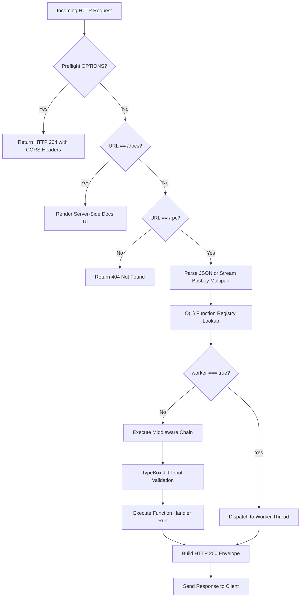

# Architecture & Execution Protocol

CellsWeb RPC Node is designed for sub-millisecond execution, complete type safety, and predictable client-server interaction.

---

## 🏛️ Core Design Principles

### 1. Single-Endpoint Architecture (`POST /rpc`)
Instead of managing dozens of distinct REST endpoints, CellsWeb RPC unifies all operations under a single endpoint:

$$\text{POST } /rpc$$

Every incoming request payload is structured as:
```json
{
  "namespace": "user",
  "functionName": "getProfile",
  "data": { "id": "usr_101" }
}
```

### 2. $O(1)$ Function Dispatching
During server bootstrap, `CoreRPC` discovers all functions matching `src/functions/**/run.{ts,js}` and indexes them into an in-memory hash map:

$$\text{key} = \text{namespace} + \text{"."} + \text{functionName}$$

Nested namespaces like `admin.billing.invoices` are automatically parsed and keyed. Function lookup executes in $O(1)$ constant time with zero regex evaluation.

---

## 📦 Uniform HTTP 200 Protocol

CellsWeb RPC uses a uniform HTTP status code protocol: **every business error, validation failure, and authentication check returns HTTP Status 200 with a structured envelope**.

### Success Envelope
```json
{
  "status": "ok",
  "data": {
    "id": "usr_101",
    "name": "Alex"
  },
  "meta": {
    "requestId": "req_8f1d3e2a",
    "durationMs": 0.45
  }
}
```

### Error Envelope
```json
{
  "status": "error",
  "code": "validation_error",
  "message": "Input validation failed: 1 field error(s)",
  "details": [
    {
      "field": "email",
      "rule": "format",
      "message": "Expected email format"
    }
  ],
  "meta": {
    "requestId": "req_8f1d3e2a",
    "durationMs": 0.28
  }
}
```

### Standard Error Codes
| Code | Description |
| :--- | :--- |
| `validation_error` | Payload failed TypeBox input schema validation |
| `unauthorized` | Authentication header missing or invalid |
| `forbidden` | Authenticated actor lacks necessary role/permission |
| `not_found` | Target function or database resource does not exist |
| `rate_limit_exceeded`| Rate limit exceeded |
| `invalid_body` | Malformed JSON or invalid top-level request envelope |
| `internal_error` | Unhandled server exception or missing middleware |

---

## ⚡ JIT TypeBox Validation Acceleration

Standard runtime validation libraries (Zod, Yup, Joi) interpret schemas on every request, creating significant CPU overhead under high load.

CellsWeb RPC uses **TypeBox JIT compilation** via `TypeCompiler.Compile(schema)`:
- Runtime validators are JIT-compiled into raw V8 TurboFan machine code instructions.
- Validators are cached in a `WeakMap`.
- Validation executes in **<0.8 microseconds** per request.

---

## 🔄 Request Execution Pipeline


