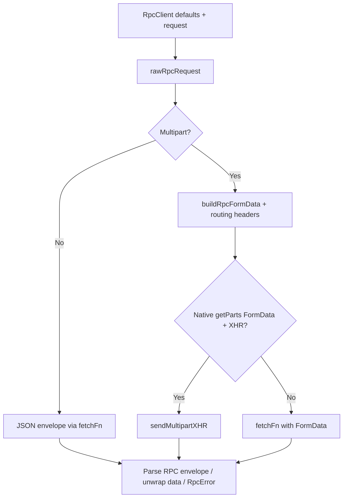
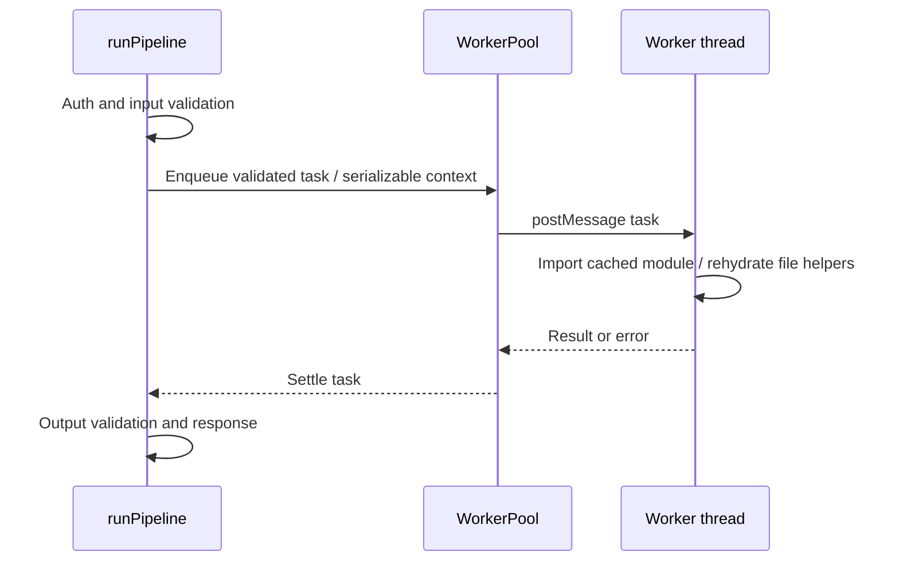

# Client SDK, React/RN and worker execution

These are two different boundaries: client transport prepares a remote request;
workers execute already-authorized server work. Neither is an authorization API.

## RpcClient and rawRpcRequest

[packages/rpc-client/src/client.ts](https://github.com/CellsWeb/crpc-node/blob/main/packages/rpc-client/src/client.ts) implements RpcClient,
createRpcClient and rawRpcRequest. RpcClient resolves dynamic default headers/body,
combines per-request settings and delegates. Plain object defaults are shallow
merged; arrays/scalars/null keep shape rather than becoming object spreads.
Undefined data can fall back to defaultBody or an empty object. These are SDK
request-building semantics, distinct from the server's HTTP omission rule.

rawRpcRequest chooses a URL/rpcEndpoint, creates abort/timeout plumbing and sends
an envelope for JSON. It parses the response status field, returns successful
data and throws RpcError on RPC errors/parse/network failures. The word raw does
not mean its return value is an HTTP envelope. User credentials belong in headers.

## File serialization and real browser behavior

[packages/rpc-client/src/multipart.ts](https://github.com/CellsWeb/crpc-node/blob/main/packages/rpc-client/src/multipart.ts) detects Blob/File and RN
URI objects, adds body routing first, preserves direct file arrays and maps
reserved data keys namespace/functionName to _data_namespace/_data_functionName.
Forbidden prototype keys are excluded. Nested file objects are rejected before
transmission; ordinary nested JSON text is not a nested file transport feature.

Standard web FormData uses fetchFn even when XMLHttpRequest exists. Native bridge
FormData exposes a callable getParts() consumed by React Native's networking
bridge; that representation retains XHR when available, including forced text
multipart, and does **not** invoke fetchFn. JSON and multipart without native XHR
use fetchFn. This checks the constructed FormData representation rather than
guessing the runtime from navigator.product or a Hermes global. A custom FormData
polyfill must preserve the native bridge contract to use that compatibility path.

RN URI descriptors remain normalized as {uri,name,type}; this does not make them
uploadable by ordinary browser FormData. File arrays and nested-file rejection
are unchanged. Let the selected transport supply Content-Type/boundary. Browser
custom fetch wrappers must forward the supplied headers, body and AbortSignal.
The SDK has no upload-progress callback API; native XHR cancellation/error handlers
remain unchanged. Full device/Hermes file I/O requires a native application test.

Client1.0.25 includes this correction;1.0.24 and older select XHR whenever it
exists. See [client transport configuration](../client.md#multipart-fetch-configuration).

## React entrypoint

[packages/rpc-client/src/react/context.tsx](https://github.com/CellsWeb/crpc-node/blob/main/packages/rpc-client/src/react/context.tsx) provides RpcProvider and
useRpcClient. useRpcQuery manages enabled/data/header dependencies, in-flight
identity/abort and refetch state; useRpcMutation manages mutate/loading/error/reset.
Both take options objects. They are application conveniences, not a global cache,
authorization boundary or idempotency system. React is optional for the base
package; hooks are imported from @cellsweb/rpc-client/react.

The [user client guide](../client.md) contains compiled TSX examples. React Native
file descriptors are supported as described above, but documentation builds and
Node/browser-shaped tests are not a real-device certificate.

## WorkerPool on the server

Source: [packages/rpc-core/src/workers/worker-pool.ts](https://github.com/CellsWeb/crpc-node/blob/main/packages/rpc-core/src/workers/worker-pool.ts).
A top-level worker=true function export selects the pool in runPipeline, **after**
middleware/function-header/input validation. The default pool size is bounded
between2 and8 according to available CPUs. Tasks include module path, validated
input, serializable context and an ID; the worker imports/caches the module and
returns a result or error. The parent performs output validation.

Raw req/functions/AbortSignal are excluded from serialized context. File helpers
are rehydrated around temporary paths; they are not transferred live sockets or
arbitrary application instances. Do not assume structured cloning preserves every
custom prototype. Parent timeouts reject waiting work; do not claim they forcibly
cancel all CPU work or permit storing request temp files after cleanup.

CoreRPC.close owns framework server/pool shutdown, not arbitrary app timers or
third-party resources. Test worker success/error/shutdown and file access while
request ownership is valid. Declaration consumers and client multipart tests are
separate gates; see [testing](testing.md).
