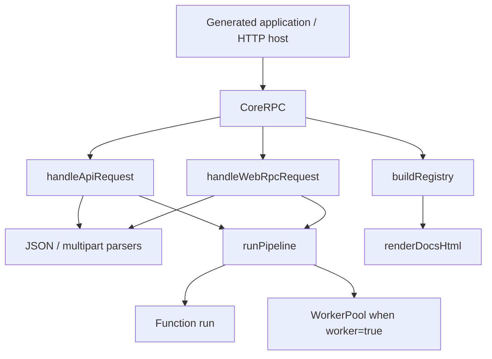

# Node architecture and source map

Start here when implementing a change. Read [shared contracts](protocol.md), then
trace [one request](lifecycle.md). Public usage stays in the user guides; these
pages describe actual released internals, not a proposed refactor.

## Design and package ownership

Functions have a route key, schema contracts and a transport-neutral handler.
Middleware enriches trusted context. Parsers adapt transport input; the pipeline
owns validation/dispatch; wrappers own response serialization and file cleanup.
Node and Go intentionally use different native implementations.

| Real path | Owner/responsibility | First test to inspect |
|---|---|---|
| [packages/rpc-core/src/core-rpc.ts](https://github.com/CellsWeb/crpc-node/blob/main/packages/rpc-core/src/core-rpc.ts) | CoreRPC options, registry lifetime, route wrappers, adapters, execute and server/worker shutdown | core-rpc.test.ts; framework-integration.test.ts |
| [packages/rpc-core/src/registry.ts](https://github.com/CellsWeb/crpc-node/blob/main/packages/rpc-core/src/registry.ts) | Registry interfaces, buildRegistry, function/middleware imports and precedence | core-rpc.test.ts; security-hardening.test.ts |
| [packages/rpc-core/src/pipeline.ts](https://github.com/CellsWeb/crpc-node/blob/main/packages/rpc-core/src/pipeline.ts) | executeMiddlewareChain/runPipeline, headers/input/output, timeout and worker choice | core-rpc.test.ts; union-validation.test.ts |
| [packages/rpc-core/src/context.ts](https://github.com/CellsWeb/crpc-node/blob/main/packages/rpc-core/src/context.ts) | MiddlewareContext, request ID/IP and Node/Web context builders | framework-integration.test.ts |
| [packages/rpc-core/src/interceptor.ts](https://github.com/CellsWeb/crpc-node/blob/main/packages/rpc-core/src/interceptor.ts) and [packages/rpc-core/src/interceptor-web.ts](https://github.com/CellsWeb/crpc-node/blob/main/packages/rpc-core/src/interceptor-web.ts) | Transport orchestration, pre-file auth, envelopes, telemetry and cleanup | security-hardening.test.ts; web-standards.test.ts |
| [packages/rpc-core/src/request/index.ts](https://github.com/CellsWeb/crpc-node/blob/main/packages/rpc-core/src/request/index.ts) | Content-kind/parser dispatcher | security-hardening.test.ts |
| [packages/rpc-core/src/request/json.ts](https://github.com/CellsWeb/crpc-node/blob/main/packages/rpc-core/src/request/json.ts) | Preparsed/raw/stream JSON, omission default and bounded rejection drain | security-hardening.test.ts |
| [packages/rpc-core/src/request/multipart.ts](https://github.com/CellsWeb/crpc-node/blob/main/packages/rpc-core/src/request/multipart.ts) and [packages/rpc-core/src/request/web.ts](https://github.com/CellsWeb/crpc-node/blob/main/packages/rpc-core/src/request/web.ts) | Stream/Fetch intake, fields/files, limits, abort and temporary paths | multipart-lifecycle.test.ts; web-standards.test.ts |
| [packages/rpc-core/src/utils/typebox.ts](https://github.com/CellsWeb/crpc-node/blob/main/packages/rpc-core/src/utils/typebox.ts) | TypeBox checking/defaults/transforms and custom file kinds | union-validation.test.ts |
| [packages/rpc-core/src/uploads/types.ts](https://github.com/CellsWeb/crpc-node/blob/main/packages/rpc-core/src/uploads/types.ts) | UploadedFile properties/read methods | web-standards.test.ts |
| [packages/rpc-core/src/test-caller.ts](https://github.com/CellsWeb/crpc-node/blob/main/packages/rpc-core/src/test-caller.ts) | createTestCaller wrapper around execute and expectation helpers | core-rpc.test.ts |
| [packages/rpc-core/src/logger.ts](https://github.com/CellsWeb/crpc-node/blob/main/packages/rpc-core/src/logger.ts), [telemetry.ts](https://github.com/CellsWeb/crpc-node/blob/main/packages/rpc-core/src/telemetry.ts) | Structured logging and telemetry types; callbacks invoked by wrappers | framework-integration.test.ts |
| [packages/rpc-core/src/utils/timing.ts](https://github.com/CellsWeb/crpc-node/blob/main/packages/rpc-core/src/utils/timing.ts) | Duration and promise timeout helpers | framework-integration.test.ts |
| [packages/rpc-core/src/request/content-type.ts](https://github.com/CellsWeb/crpc-node/blob/main/packages/rpc-core/src/request/content-type.ts), [routing.ts](https://github.com/CellsWeb/crpc-node/blob/main/packages/rpc-core/src/request/routing.ts) | Kind/identifier checks shared by intake | security-hardening.test.ts |
| [packages/rpc-core/src/errors.ts](https://github.com/CellsWeb/crpc-node/blob/main/packages/rpc-core/src/errors.ts) | AppError/ErrorCode/client projection/status mapping | core-rpc.test.ts |
| [packages/rpc-core/src/docs/renderer.ts](https://github.com/CellsWeb/crpc-node/blob/main/packages/rpc-core/src/docs/renderer.ts) | Docs HTML, schema views, route selection and public middleware projection | docs-parity.test.ts; fetch-docs.test.ts |
| [packages/rpc-core/src/workers/worker-pool.ts](https://github.com/CellsWeb/crpc-node/blob/main/packages/rpc-core/src/workers/worker-pool.ts) | WorkerPool task queue, worker lifecycle and file rehydration | framework-integration.test.ts |
| [packages/rpc-client/src/client.ts](https://github.com/CellsWeb/crpc-node/blob/main/packages/rpc-client/src/client.ts) | RpcClient/rawRpcRequest, URL/body/header merge, fetch/XHR and RpcError | client.test.ts |
| [packages/rpc-client/src/multipart.ts](https://github.com/CellsWeb/crpc-node/blob/main/packages/rpc-client/src/multipart.ts) | File/RN-file detection and form serialization | multipart.test.ts |
| [packages/rpc-client/src/react/index.ts](https://github.com/CellsWeb/crpc-node/blob/main/packages/rpc-client/src/react/index.ts) | Separate React provider/query/mutation export graph | TypeScript public-consumer checks |
| [packages/create-cellsweb-rpc-api/bin/create.js](https://github.com/CellsWeb/crpc-node/blob/main/packages/create-cellsweb-rpc-api/bin/create.js) | Initializer/template copying/generated manifest and adapter choice | test/server-types.test.mjs; test/server-docs.test.mjs |

Core's [export surface](https://github.com/CellsWeb/crpc-node/blob/main/packages/rpc-core/src/index.ts) is separate
from implementation layout. Not every file is a public package subpath. Declarations
are built in dist; edit src and keep the import/require type graphs consistent.
There is no registry/index.ts or rpc-core/adapters directory in this released
tree. Root turbo.json defines optional Turbo tasks, while the actual package.json
scripts use recursive pnpm. Trace the invoked command rather than assuming all
builds use Turbo caching.

Continue with [registration/context](registration.md), [validation](validation.md),
[transports/adapters/uploads](transports.md), [client/workers](client-workers.md),
[renderer](renderer.md), [CLI](tooling.md), [testing](testing.md) and
[release engineering](releasing.md). The [Go map](https://cellsweb.github.io/crpc-go/internals/)
explains its explicit registration and native pipeline sites.
