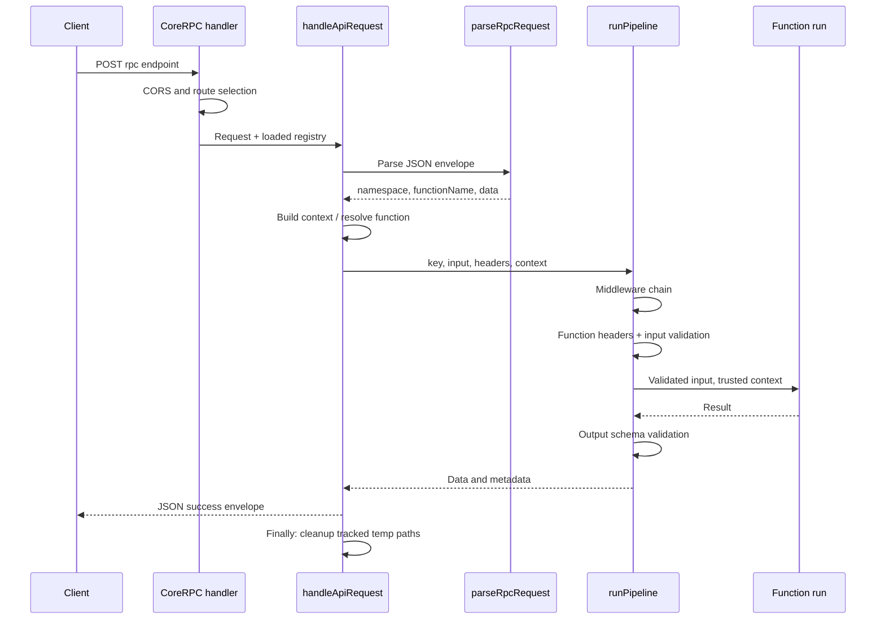

# Node request execution lifecycle

The entrypoint depends on the host; it is not the handler's responsibility to
know whether the request arrived through native HTTP, Fetch or an in-memory call.
Source: [packages/rpc-core/src/core-rpc.ts](https://github.com/CellsWeb/crpc-node/blob/main/packages/rpc-core/src/core-rpc.ts),
[packages/rpc-core/src/interceptor.ts](https://github.com/CellsWeb/crpc-node/blob/main/packages/rpc-core/src/interceptor.ts),
[packages/rpc-core/src/interceptor-web.ts](https://github.com/CellsWeb/crpc-node/blob/main/packages/rpc-core/src/interceptor-web.ts) and
[packages/rpc-core/src/pipeline.ts](https://github.com/CellsWeb/crpc-node/blob/main/packages/rpc-core/src/pipeline.ts).

## Native HTTP / JSON sequence

createHandler first loads/caches the registry, then returns the host callback.
That callback unwraps req.raw/res.raw when present, handles OPTIONS/CORS, matches
RPC, health and globally enabled docs routes, and delegates unknown paths to next
or returns404. Docs/health do not invoke the RPC middleware pipeline.

handleApiRequest detects content kind, orchestrates parsing and builds context.
JSON parsing validates the outer envelope/routing and preserves data shapes.
Missing functions or wrong content contracts fail before handler invocation.
runPipeline resolves the function and normally calls executeMiddlewareChain.

The chain prepares case-compatible schema headers, validates each middleware's
headers/options, and runs attachments in order. A returned object becomes current
context. Then function headers and input are validated, an aborted signal is
checked, and the handler runs on the main thread or worker pool with a timeout.
Output schema failure becomes schema_mismatch rather than a successful response.
Timeout rejection is not a promise of forcibly cancelling arbitrary handler code.

## Multipart changes the placement of authorization

With paired routing headers, the interceptor resolves the function and runs its
middleware before parser file writes. With body routing, onBeforeFileSave obtains
the required early routing fields and runs the same chain. A cached pre-auth
promise prevents concurrent file events from executing it repeatedly. After
parsing, redundant header/body routing is checked before the handler.

runPipeline receives the **internal** skipMiddlewares marker only because that
chain already ran during intake. It still validates function headers/input and
output. The marker is not a remote request option and must not become an auth
bypass. Parser failures clean partially created files; successful parse results
transfer cleanup paths to the interceptor's finally block.

## Fetch and in-memory paths

CoreRPC.fetch parses a URL and gives its pathname to the docs renderer. RPC
requests go through handleWebRpcRequest and parseWebRequest, then the same
runPipeline. Fetch formData() may buffer before files are inspected; its pre-file
callback protects application-owned writes, not runtime/network buffering.

CoreRPC.execute builds an in-process context and calls runPipeline directly,
without an HTTP envelope parser. It returns a success/error envelope. Local
contextOverrides are trusted server API inputs, not body fields accepted from
HTTP clients. Do not apply HTTP omission defaults to this path by assumption.

## Error and resource ownership

Interceptors catch exceptions with toAppError, project AppError.toClientPayload,
serialize safely and select HTTP200 unless useHttpStatusCodes is enabled.
Telemetry callback failures are contained. Transport/framework failures occurring
outside these wrappers may have different statuses. Cleanup runs in finally even
when schemas, middleware, handlers or output validation fail. Disconnected peers
may make a structured response impossible; draining remains bounded.

To extend intake, change the relevant parser and both transport wrappers only as
needed. To change execution, start in pipeline.ts and verify native/Fetch/execute,
pre-auth deduplication and output failures. See the [test map](testing.md).
