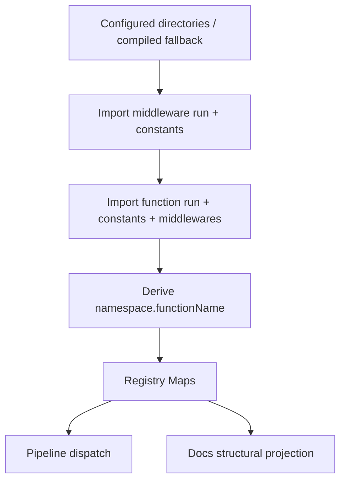

# Function discovery, middleware and context

Source: [packages/rpc-core/src/registry.ts](https://github.com/CellsWeb/crpc-node/blob/main/packages/rpc-core/src/registry.ts) and
[packages/rpc-core/src/context.ts](https://github.com/CellsWeb/crpc-node/blob/main/packages/rpc-core/src/context.ts). Discovery executes module imports;
it is not a schema-only filesystem index. Keep import side effects intentional.

## Registry lifetime and directory conventions

CoreRPC.getRegistry lazily calls buildRegistry and caches the result per app.
buildRegistry scans central middleware first, then functions, with tinyglobby's
`**/run.{ts,js}` pattern. Constants/attachment companion files can be ts/js/mjs;
that does not make run.mjs a discovered entrypoint. Native Node without a detected
TS runner probes compiled dist/.crpc directories; this heuristic is implemented
in registry.ts, not an import resolver guarantee for arbitrary layouts.

A function needs a namespace directory and a function directory. The path relative
to functionsDir supplies the namespace segments joined with dots, functionName
is the final directory, and the key is namespace.functionName. Middleware names
come from metadata.name or the directory basename. Central middleware holds its
run function plus header/options schemas and description.

## Module precedence

Function run is the named run export, a default function, or default.run. The
run module's metadata/contentType/header/input/output exports take precedence
over constants. worker is a **top-level export** of run or constants; setting
metadata.worker alone does not activate worker execution. Middleware attachments
are read from middlewares.ts/js/mjs first, then supported run/constants fallbacks.
Use the documented co-located files instead of relying on unusual fallbacks.

Strict mode defaults on in production and propagates import failures; development
can log/skip broken modules. A function that fails to register cannot be executed.
A declared middleware missing at execution fails closed in the pipeline.
Changes to discovery need tests for imported exports, invalid modules, namespace
paths, compiled layout and actual generated apps. Filesystem access is a Node/Bun
requirement; a Fetch-shaped API does not imply arbitrary Edge discovery support.

## Middleware context

executeMiddlewareChain receives headers, validated configured options, function
metadata and current MiddlewareContext. It validates middleware headers before
options, then invokes run. Attachments are ordered; context returned by one is
passed onward. Keep state namespaced by middleware name to avoid collisions.
The context includes requestId, ip, namespace, functionName, requestStartTime,
request reference and optional signal. Headers/IP are transport input; proxy trust
must be deliberate and an address is not an authenticated identity.

Application middleware must verify credentials and establish trusted state.
The framework is not a JWT/session provider. Function headers/input are checked
later by runPipeline. Server-local contextOverrides/test helpers are not remote
HTTP/IPC options. Worker context is serialized differently; see
[client/workers](client-workers.md). Avoid handler dependence on raw req/socket
when it must also run through Fetch or in-memory execution.

## Safe changes

Adding optional documentation metadata should not alter middleware execution.
Keep isPublic ignored and retain source compatibility. Verify import/export
precedence before adding generator fields. Tests in core-rpc.test.ts and
security-hardening.test.ts plus generated-project suites exercise these paths;
[the test map](testing.md) links the exact locations.
