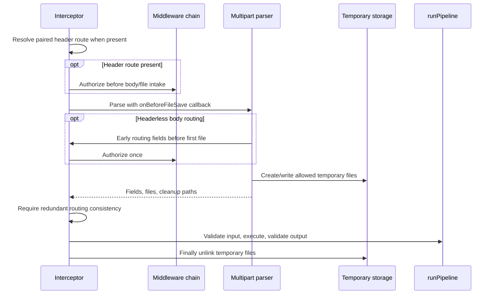

# JSON, multipart and seven adapter boundaries

Source entrypoints: [packages/rpc-core/src/request/index.ts](https://github.com/CellsWeb/crpc-node/blob/main/packages/rpc-core/src/request/index.ts),
[packages/rpc-core/src/request/json.ts](https://github.com/CellsWeb/crpc-node/blob/main/packages/rpc-core/src/request/json.ts),
[packages/rpc-core/src/request/multipart.ts](https://github.com/CellsWeb/crpc-node/blob/main/packages/rpc-core/src/request/multipart.ts) and
[packages/rpc-core/src/request/web.ts](https://github.com/CellsWeb/crpc-node/blob/main/packages/rpc-core/src/request/web.ts).

## JSON ownership

parseJsonRequest accepts an adapter-preparsed object, supported raw body data,
or the native request stream. It validates the envelope object and routing;
explicit data:null stays null, omitted data becomes an empty object. If another
framework already buffered/parsed the body, its intake limit remains important.
The native stream default is1,048,576 bytes (MAX_JSON_BODY_BYTES overrides it).

On an oversized native body, normal chunk listeners are removed and accumulated
chunks released. Rejection draining is bounded by512KiB additional bytes and a
2-second deadline, with request/socket/timer listeners cleaned up. It preserves
an RPC error where the connection can still be used; it is not a promise of a
response to an unlimited/slow/disconnected peer. Test actual HTTP, not just a
synthetic parser object, when changing this lifecycle.

## Multipart intake sequence

Busboy's native limits are20 files,100 fields,150 parts and1MiB per field.
Default payload/file bounds are25,000,000 and10,000,000 bytes, controlled by
MAX_MULTIPART_BYTES/MAX_UPLOAD_FILE_BYTES or applicable parser options. Parser
accounting and a whole network request's byte count are not interchangeable.
UPLOAD_TMP_DIR selects the application temp directory (default OS temp plus
cellsweb-uploads); newly created directories/files request0700/0600 permissions.
Filenames are sanitized; MIME detection is heuristic, not malware sanitization.

Native multipart pauses intake around authorization, streams file chunks to disk,
tracks writes and cleans partial files on error. Successful paths transfer cleanup
ownership to the interceptor. close is not always an abort: completion uses native
complete when available and readableEnded otherwise, needed by Ultimate Express.
Abort paths destroy/retire streams, bound draining and detach listeners. Do not
remove these distinctions to make a happy-path upload pass.

Fetch uses request.formData(), which can buffer in the runtime before size/part
checks. parseWebRequest then checks fields/files, runs the pre-save callback and
creates physical UploadedFile values. Header authorization can occur before
formData; headerless authorization occurs after form parsing but before
application-owned file writes. This boundary cannot promise zero RAM or network
backpressure equivalent to Busboy.

## Actual adapter map

| Host | Released template/integration | Body ownership |
|---|---|---|
| Native Node | server.node.ts / createHandler | IncomingMessage → Busboy/JSON stream |
| Express | server.express.ts / createHandler | Host handles JSON; keep multipart raw for CRPC |
| Ultimate Express | server.ultimate-express.ts / createHandler | Native-style stream with different completion properties |
| Fastify | server.fastify.ts / createFastifyPlugin | JSON parser is upstream; multipart pass-through parser leaves payload unconsumed |
| Bun | server.bun.ts / fetch | Request/Response/formData runtime boundary |
| Elysia | server.elysia.ts / Fetch integration | Disable conflicting host body consumption; use Web intake |
| Hono | server.hono.ts / Fetch integration | Web intake; tested Node host uses @hono/node-server |

Templates are under [packages/create-cellsweb-rpc-api/templates/servers](https://github.com/CellsWeb/crpc-node/tree/main/packages/create-cellsweb-rpc-api/templates/servers).
Fastify's plugin registers its non-consuming multipart parser only when absent;
existing parser behavior remains the integrator's responsibility. Route handlers
hijack the reply and use native request/response objects. Do not register a parser
that drains the multipart payload before Busboy. Keep host JSON limits/config and
custom endpoints in compatibility tests.

## Persistence and regression scope

UploadedFile exposes path/filename/byteLength/MIME properties and read methods.
Persist to application-owned storage during handling; cleanup can remove the temp
path after the response. Reading toBuffer/toBlob allocates content by choice.
Do not retain temporary paths for asynchronous work after request completion.

Use real HTTP file arrays, empty files, all byte values, malformed boundaries,
oversized/partial/slow/disconnected uploads and repeated requests. Assert routing
mismatch rejection, auth-before-write, listener/timer cleanup and absence of temp
files. The [test map](testing.md) links lifecycle and seven-adapter probes.
