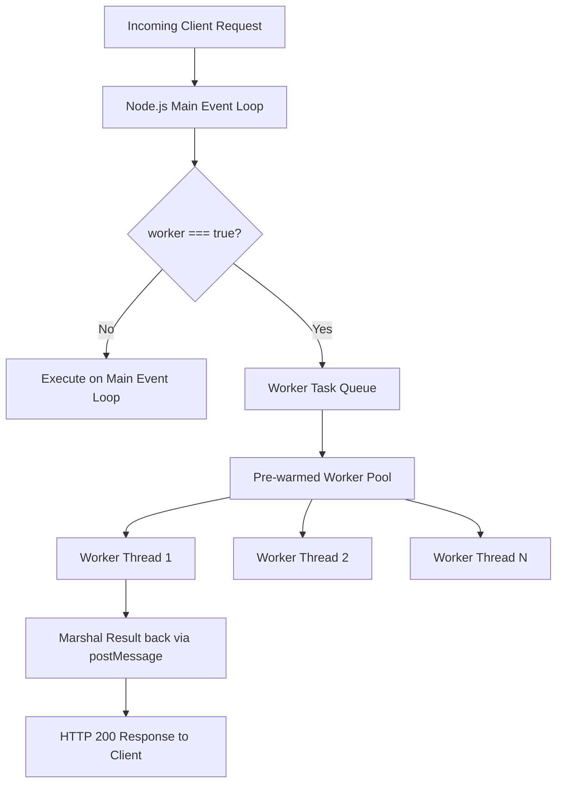

# Multi-Threading via Worker Threads

Node.js executes JavaScript on a single-threaded event loop. CPU-intensive operations (cryptography, image transformations, PDF generation, heavy JSON serialization) can block the event loop, causing request latency to skyrocket for all concurrent users.

CellsWeb RPC solves this with **Declarative Worker Thread Multi-Processing**.

---

## ⚡ Enabling Worker Threads: `worker = true`

To offload an RPC function to a background worker thread, simply export `worker = true` in its `constants.ts`:

```typescript
// src/functions/reports/generatePdf/constants.ts
import { Type, type Static } from "@sinclair/typebox";

export const metadata = {
  description: "CPU-heavy PDF report generation",
  tags: ["reports"],
};

// 🚀 Instructs CoreRPC to execute this function in a worker thread!
export const worker = true;

export const inputSchema = Type.Object({
  reportId: Type.String(),
  rows: Type.Array(Type.Any()),
});

export const outputSchema = Type.Object({
  pdfBase64: Type.String(),
  generationTimeMs: Type.Number(),
});

export type Input = Static<typeof inputSchema>;
export type Output = Static<typeof outputSchema>;
```

### Handler (`run.ts`)
The handler remains a standard async function. No worker boilerplate is required:

```typescript
// src/functions/reports/generatePdf/run.ts
import type { Input, Output } from "./constants";
import type { Context } from "@cellsweb/rpc-core";

export default async function run(data: Input, ctx: Context): Promise<Output> {
  const start = Date.now();

  // Heavy CPU work happens off the main event loop!
  const pdfBytes = heavyPdfRendering(data.rows);

  return {
    pdfBase64: Buffer.from(pdfBytes).toString("base64"),
    generationTimeMs: Date.now() - start,
  };
}
```

---

## 🏗️ Worker Thread Pool Architecture



### Key Engineering Features
1. **Pre-Warmed Pool**: Worker threads are initialized during server startup, eliminating dynamic thread spawn latency.
2. **ESM Dynamic Imports**: Worker threads dynamically load function modules via native ESM `import()`.
3. **Automatic Crash Recovery**: If a worker thread terminates unexpectedly or runs out of memory, the pool immediately spawns a fresh replacement worker.
4. **Synchronous Throw Guard**: Protects against uncloneable objects in `worker.postMessage()`, preventing deadlocks in active task queues.
